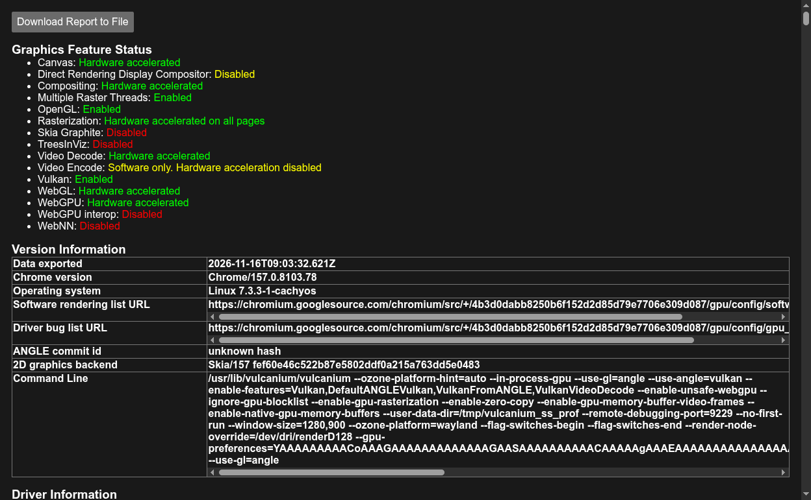

<div align="center">


# Vulcanium

Chromium with Vulkan rendering and Vulkan Video Decoding / Encoding

</div>

## Features

- **Native Wayland + Vulkan (`patches/wayland/`, `patches/vulkan/`):**
  - Out-of-process GPU rendering (`GaneshVulkan` + `ANGLE_VULKAN`) via DMA-BUF (`gbm_device` / Vulkan linear modifier fallback), `VK_IMAGE_LAYOUT_GENERAL` transitions, and preserved CSD window alpha.
- **Vulkan Video Decoding & Encoding (`patches/video-decode/`, `patches/video-encode/`):**
  - `VulkanVideoDecoder` (H.264, HEVC/H.265, VP9, AV1) backed by FFmpeg Vulkan hwaccel with zero-copy GPU `vkCmdCopyImage` → 2-plane DMA-BUF → `MailboxVideoFrameConverter` (`SharedImage`) output.
  - `VulkanVideoEncodeAccelerator` (H.264, HEVC/H.265) backed by FFmpeg `h264_vulkan` and `hevc_vulkan` (`VK_KHR_video_encode_queue`).
- **Isolated Branding & Safe Defaults (`patches/branding/`, `config/`):**
  - Separate profile directory, default Wayland/Vulkan runtime flags, and automatic launcher neutralization of conflicting VA-API flags.

## Install (Arch Linux / AUR)

Prebuilt portable `x86_64` binaries (`-bin`) and source packages are available on the AUR:

- [`vulcanium`](https://aur.archlinux.org/packages/vulcanium) / [`vulcanium-bin`](https://aur.archlinux.org/packages/vulcanium-bin)
- [`ungoogled-vulcanium`](https://aur.archlinux.org/packages/ungoogled-vulcanium) / [`ungoogled-vulcanium-bin`](https://aur.archlinux.org/packages/ungoogled-vulcanium-bin)

## Build

### Arch Linux (`makepkg`)

```bash
cd arch
makepkg -si
```

### Standalone (`gn` + `ninja`)

```bash
./scripts/fetch-source.sh
./scripts/apply-patches.sh
./scripts/build.sh
```

## Screenshots

### Graphics Feature Status (`chrome://gpu`)


### Driver Information (`GaneshVulkan` + `ANGLE_VULKAN`)


### Video Acceleration Information (Decode & Encode)


## Notes & Limitations

- Runs with the standard out-of-process GPU process (`--in-process-gpu` is not used).
- Tested on Arch Linux, KDE Plasma Wayland, and NVIDIA RTX 3060 (AMD and Intel GPUs are currently untested).
