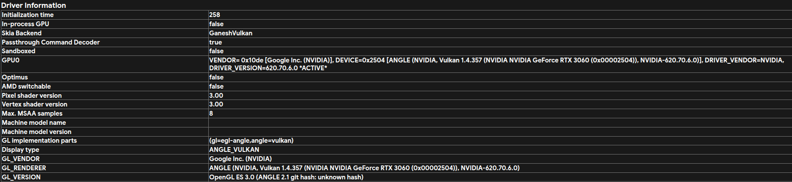

# Vulcanium

Chromium `157.0.8103.78` patch set and Arch Linux packaging focused on native **Linux Wayland + Vulkan** rendering and **Vulkan Video** hardware decoding across NVIDIA, AMD, and Intel GPUs.

## Features

- **Native Wayland + Vulkan (`patches/wayland/`, `patches/vulkan/`):**
  - `GaneshVulkan` + `ANGLE_VULKAN` via `VK_KHR_wayland_surface` swapchain, premultiplied alpha, and Wayland windowing state synchronization.
  - DMA-BUF linear modifier fallback and `VK_IMAGE_LAYOUT_GENERAL` transitions.
- **Vulkan Video Decoding (`patches/video-decode/`):**
  - `VulkanVideoDecoder` backed by FFmpeg Vulkan hwaccel for H.264, HEVC/H.265, VP9, and AV1 with zero-copy DMA-BUF frame wrapping.
- **Isolated Branding & Defaults (`patches/branding/`, `config/`):**
  - Separate profile directory, `/usr/bin/vulcanium` launcher, and default Wayland/Vulkan/zero-copy runtime flags.

## Build

### Arch Linux (`makepkg`)

```bash
cd arch
makepkg -si
```

### Standalone (`gn` + `ninja`)

```bash
./scripts/fetch-source.sh
./scripts/apply-patches.sh
./scripts/build.sh
```

## Screenshots

### Graphics Feature Status (`chrome://gpu`)


### Driver Information (`GaneshVulkan` + `ANGLE_VULKAN`)


### Video Acceleration Information (`H.264`, `HEVC`, `VP9`, `AV1`)


## Notes & Limitations

- Targets Chromium `157.0.8103.78`.
- Uses `--in-process-gpu` so `VK_KHR_wayland_surface` shares Wayland surface handles directly.
- Tested on Arch Linux, KDE Plasma Wayland, and NVIDIA RTX 3060.
